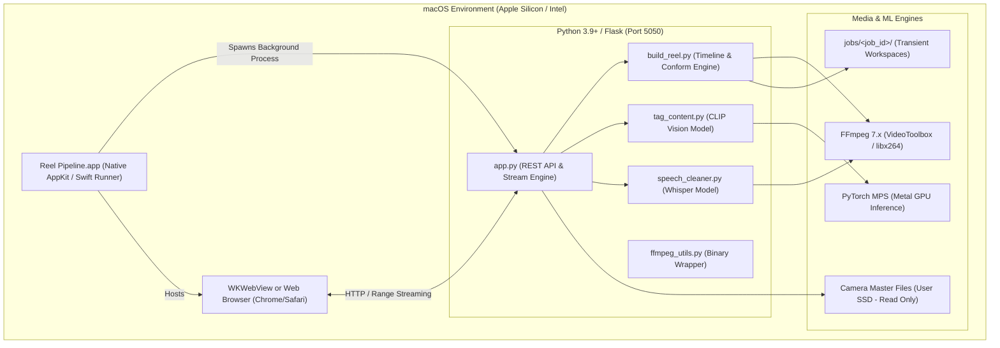

# Reel Pipeline — Developer & AI Architecture Manual

> **Target Audience:** Software engineers, machine learning engineers, and autonomous AI coding agents working on, maintaining, or extending this repository.
> **Repository Path:** `AI Editor/reel_pipeline`
> **Last Updated:** October 2026

---

## 1. Executive Summary & Architectural Philosophy

Reel Pipeline (internally named **Swift Reel Studio**) is a professional, non-destructive, offline-first Short-Form Video NLE (Non-Linear Editor) designed specifically for vertical social video (9:16 reels, TikToks, YouTube Shorts) and seamless handoff into industry-standard digital intermediate suites (**DaVinci Resolve Studio** and **Adobe Premiere Pro**).

### Core Architectural Principles
1. **100% Offline & Zero Cloud Dependencies:** No footage, audio, or metadata ever leaves the host machine. AI models (**OpenAI CLIP** and **OpenAI Whisper**) execute locally using Apple Silicon Metal Performance Shaders (`torch.backends.mps`) or local CPU AVX2 instructions.
2. **Non-Destructive Editing Guarantee:** Original camera master files on the user's SSD are treated as strictly immutable and read-only. Edits (trims, grade transforms, speed ramps, reverse states, framing) are stored as declarative parameters in JSON project manifests (`project.reelproj`, `shot_plan.json`) and baked only during export or cached in temporary working directories.
3. **DaVinci Resolve / Premiere Pro Relink Parity:** Generated **Final Cut Pro XML (FCPXML v1.9)** and **CMX 3600 EDL** files preserve exact source clip file paths, audio sample rates, and SMPTE timecodes. Resolve can relink all cuts directly to raw 4K/6K camera masters with zero conform drift.
4. **Hardware Acceleration First:** Video encoding and playback proxies prioritize macOS VideoToolbox (`h264_videotoolbox`, `hevc_videotoolbox`) before falling back to CPU x264/x265 presets.
5. **Zero-Latency Dual-Deck Playback:** The live preview monitor uses two synchronized HTML5 video elements (Deck A and Deck B). While Deck A is playing the active clip, Deck B preloads the upcoming shot at its cut in-point, enabling 0-millisecond instant cuts with zero black flash.

---

## 2. System Topology & Process Model



### Process Lifecycle
1. **Bootstrap (`Reel Pipeline.app` / `native_app/ReelPipelineRunner`):**
   - The compiled Swift executable (`native_app/main.swift`) initializes a native `NSApplication` with AppKit menu items (Undo, Redo, Cut, Copy, Paste, Save, Open).
   - It checks whether port `5050` is listening. If inactive, it spawns `Python app.py` as a detached child process.
   - It opens a native `NSWindow` containing a `WKWebView` pointed at `http://127.0.0.1:5050`.
   - On application termination (`⌘Q`), the Swift delegate issues an HTTP `POST /api/quit_app` before terminating the Python subprocess.

2. **Server Runtime (`app.py`):**
   - Flask server listening on `127.0.0.1:5050`.
   - Serves static assets, REST APIs, and chunked HTTP 206 Partial Content video streams for scrubbing.
   - Maintains isolated job directories under `jobs/<job_id>/`.

---

## 3. Directory & File Inventory

```
AI Editor/reel_pipeline/
├── DEVELOPMENT.md             # This technical reference manual
├── USER_GUIDE.md              # User manual and tutorials
├── TECH_STACK.md              # High-level architecture summary
├── README.md                  # Quickstart guide
├── requirements.txt           # Python package dependencies
├── app.py                     # Primary Flask REST API and file server
├── build_reel.py              # Timeline renderer, color filtergraph, and FCPXML/EDL builder
├── tag_content.py             # OpenAI CLIP visual classification and smart matching
├── speech_cleaner.py          # OpenAI Whisper speech recognition and silence cutter
├── sort_media.py              # Batch footage organizer powered by CLIP
├── export_platforms.py        # Preset delivery encoder (IG, TikTok, Shorts, YouTube 4K)
├── ffmpeg_utils.py            # FFmpeg executable resolution and probe utilities
├── launch_app.sh              # macOS shell launcher
├── models/                    # Cached neural network weights
├── native_app/
│   ├── main.swift             # Native macOS Cocoa/WebKit wrapper source
│   └── ReelPipelineRunner     # Compiled binary runner
├── static/
│   ├── app.js                 # Complete NLE frontend client (4,600+ lines)
│   └── style.css              # Custom DaVinci Resolve-inspired dark UI theme
├── templates/
│   ├── index.html             # Primary Beat Sync Studio interface
│   ├── cleaner.html           # Speech & Silence Cleaner interface
│   ├── sorter.html            # AI Media Sorter interface
│   └── history.html           # Project History and Job Manager
├── custom_fonts/              # User-uploaded TTF/OTF typography
└── jobs/                      # Working directories for each edit session
    └── <job_id>/
        ├── project.reelproj   # Declarative project state JSON
        ├── shot_plan.json     # Current timeline shots and transforms
        ├── text_track.json    # CapCut/Premiere-style text layers
        ├── rhythm.json        # Reference video beat/cut analysis
        ├── clip_tags.json     # CLIP scene embeddings
        ├── reversed_cache/    # Hardware-accelerated reverse proxies
        ├── thumbs/            # Cached 120x80 timeline thumbnails
        └── built_reel.mp4     # Master rendered output
```

---

## 4. Key Subsystems & Core Modules

### 4.1. Core Server & API Layer (`app.py`)
* **Job State Architecture:** Every edit session is identified by a 12-character hex ID (`job_id`). `jobs/<job_id>/` contains all transient manifests and rendered files.
* **Key Endpoints:**
  * `POST /api/analyze`: Ingests a reference video, executes PySceneDetect, and returns detected cut timestamps and rhythm durations.
  * `POST /api/tag`: Executes OpenAI CLIP against raw footage to generate scene labels (food, person, kitchen, etc.).
  * `POST /api/build`: Bakes all timeline trims, grades, reframes, text layers, audio tracks, and reverse states into a master MP4.
  * `GET /api/clip_preview/<job_id>/<clip_name>`: HTTP 206 range-request stream of forward footage.
  * `GET /api/clip_reversed/<job_id>/<clip_name>?in=X&dur=Y`: Full-resolution reversed video stream. Encoded via `h264_videotoolbox` at 28 Mbps and cached in `jobs/<job_id>/reversed_cache/`.
  * `POST /api/project_save` / `POST /api/project_open`: Imports/exports standalone `.reelproj` bundle archives.

### 4.2. Timeline Renderer & Conform Engine (`build_reel.py`)
This is the mathematical core of the pipeline. It translates the declarative timeline state into FFmpeg commands and FCPXML/EDL documents.

* **Filtergraph Construction:**
  For each shot $i$, `build_reel.py` constructs a customized FFmpeg filter chain:
  1. **Spatial Reframe (Pan & Zoom):**
     $$\text{scale}=w=\text{trunc}\left(\max(W, iw \cdot \frac{H}{ih}) \cdot z / 2\right) \cdot 2, \quad \text{crop}=W:H:dx:dy$$
  2. **Temporal Reverse:**
     $$\text{trim}=\text{duration}=D, \quad \text{setpts}=\text{PTS-STARTPTS}, \quad \text{reverse}$$
  3. **RGB White Balance (DaVinci Resolve-style Matrix):**
     Uses `colorchannelmixer` with temperature (amber/blue) and tint (green/magenta) coefficients:
     $$\text{rr} = 1.0 + \frac{T}{100} \cdot 0.38, \quad \text{bb} = 1.0 - \frac{T}{100} \cdot 0.38, \quad \text{gg} = 1.0 - \frac{\text{tint}}{100} \cdot 0.28$$
  4. **Levels & Tonality (`eq` filter):**
     Applies brightness, contrast, and saturation offsets.
  5. **3D LUT Application (`lut3d`):**
     Applies `.cube` color transforms in tetrahedral interpolation mode.
  6. **Vignette (`vignette`):**
     Applies cosine lens falloff.
  7. **Fade Transitions (`fade`):**
     Calculates in/out fades to black without requiring multi-layer compositing.

* **DaVinci Resolve FCPXML (v1.9) Generation:**
  * Outputs standardized Apple Final Cut Pro XML.
  * Preserves exact source clip paths via `file://` URIs.
  * Converts seconds to rational time intervals: `duration="150/100s"`.
  * Generates unique clip items and lane tracks so DaVinci Resolve never collapses cuts into a single media pool item.

* **CMX 3600 EDL Generation:**
  * Produces standard 8-column EDL event lists for legacy NLE workflows.
  * Dynamically computes Reel IDs and SMPTE timecodes (`HH:MM:SS:FF`) at 30 or 60 FPS.

### 4.3. Visual Intelligence Engine (`tag_content.py`)
* **Model:** OpenAI CLIP (`openai/clip-vit-base-patch32`).
* **Framework:** PyTorch with Apple Metal MPS acceleration (`torch.device("mps")`).
* **Algorithm:**
  1. Extracts a representative frame from the center of each candidate clip via FFmpeg.
  2. Preprocesses the image into a $224 \times 224$ tensor normalized by ImageNet mean and standard deviation.
  3. Computes cosine similarities between image embeddings and text candidate embeddings:
     $$\text{score}(I, T_k) = \frac{I \cdot T_k}{\|I\|_2 \|T_k\|_2}$$
  4. Assigns the highest-probability category tag (`food`, `kitchen`, `exterior`, etc.) to the shot plan.

### 4.4. Audio Intelligence Engine (`speech_cleaner.py`)
* **Model:** OpenAI Whisper (`base` or `small`).
* **Algorithm:**
  1. Extracts dialogue track to 16 kHz mono WAV.
  2. Performs word-level transcription with start and end timestamps.
  3. Analyzes inter-word gaps $> 450\text{ ms}$ (dead air) and acoustic hesitation tokens ("um", "uh", "er").
  4. Computes an inverted "keep-segments" list.
  5. Slices audio and video into clean micro-segments and concatenates them with zero pitch shifting.

---

## 5. Frontend NLE Architecture (`static/app.js` & `static/style.css`)

The frontend is an uncompiled, lightweight Single-Page Application built on modern ES6+ and Web APIs.

### 5.1. DaVinci Resolve-Style 1:1 Linear Timeline
* **Time-to-Pixel Mapping:**
  All timeline tracks share an absolute linear coordinate system with a base scale of $120\text{ px/sec}$:
  $$\text{trackWidth} = \max\left(720, \text{round}(\text{totalDuration} \times 120)\right)$$
* **Track Hierarchy:**
  1. **TC Ruler (`.tl-ruler-strip`):** Dynamic timecode ticks at 1s, 2s, or 4s intervals based on zoom level.
  2. **T1 Text Track (`.tl-text-strip`):** CapCut/Premiere-style text overlay blocks.
  3. **V1 Video Track (`.tl-shots-strip`):** Contiguous, gapless video blocks (`gap: 0;`). Each block shows the in-point thumbnail as its background.
  4. **A1 Audio Track (`.tl-audio-strip`):** Waveform visualizer with left/right trim handles.
* **Scroll-Past-End Blank Runway:** All timeline tracks have `padding-right: 650px;`, allowing the user to scroll the final clip into the center of the viewport for comfortable edge trimming.

### 5.2. Current Time Indicator (CTI Playhead)
* Runs on a hardware-synchronized `requestAnimationFrame` loop at 60 FPS.
* The physical position of the playhead is locked to sequence time $t$:
  $$x(t) = \text{originX} + \frac{t}{\text{totalDuration}} \times \text{trackWidth}$$
* When the playhead crosses the cut boundary between Shot $i$ and Shot $i+1$, the preview monitor switches at the exact same sub-pixel position.

### 5.3. Zero-Latency Dual-Deck Playback Monitor
To eliminate HTML5 video load latency and black screen flicker during sequential playback:
* **Deck A (`#source-preview`)** and **Deck B (`#source-preview-b`)** sit stacked inside `#reframe-viewport`.
* Only one deck has class `.deck-active` (`opacity: 1; z-index: 2`). The other has `.deck-standby` (`opacity: 0; z-index: 1`).
* When Shot $i$ begins playing on Deck A, `preloadNextShotIntoStandby(i + 1)` sets Deck B's source to Shot $i+1$ and seeks to its in-point.
* At the cut boundary ($cur \ge outPt - 0.03\text{s}$), the decks swap classes instantaneously with zero dropped frames.

### 5.4. Unified Multi-Layer Delete
Clicking the timeline **`🗑️ Delete`** button or pressing <kbd>Delete</kbd> / <kbd>Backspace</kbd> triggers `deleteSelectedTimelineItem()`:
- If a **Text Layer** is active: removes the text title and updates the overlay.
- If the **Audio Track** is active: clears custom audio and restores synced reference audio.
- If a **Video Shot** is active: deletes the shot from `shotPlan` and updates the timeline.
- All deletions push snapshot states to the 10-step Undo stack (<kbd>⌘Z</kbd>).

---

## 6. Project Manifest Schema (`project.reelproj`)

```json
{
  "version": "2.5",
  "job_id": "ede3406fe924",
  "job_name": "Autumn Tasting Menu Reel",
  "created_at": 1792931200,
  "local_folder": "/Users/threedwizard/Movies/Autumn_Footage",
  "reference_file": "reference_reel.mp4",
  "threshold": 27.0,
  "shot_plan": [
    {
      "index": 0,
      "clip": "A001_C019.mov",
      "in_point": 1.25,
      "duration": 0.85,
      "clip_duration": 14.5,
      "crop": "center",
      "zoom": 115.0,
      "pan_x": -3.5,
      "pan_y": 2.0,
      "reverse": true,
      "grade": {
        "brightness": 5,
        "contrast": 10,
        "saturation": 8,
        "temperature": 12,
        "tint": -4,
        "whites": 3,
        "blacks": -2,
        "vignette": 15,
        "curve": "contrast",
        "fade_in": 0.0,
        "fade_out": 0.0
      },
      "tag": "food"
    }
  ],
  "text_track": [
    {
      "id": "txt_1792931250_0",
      "content": "SMOKED SHORT RIB",
      "font_family": "Bebas Neue",
      "font_size": 42,
      "color": "#FFFFFF",
      "bg_style": "semi_black",
      "pos_x": 50,
      "pos_y": 78,
      "start_time": 0.0,
      "duration": 2.1
    }
  ],
  "audio_track": {
    "custom_file": "background_music.mp3",
    "start_offset": 2.5,
    "duration": 18.2,
    "volume_pct": 85
  }
}
```

---

## 7. Developer Rules for Modifying This Codebase

When working on this codebase, any developer or AI coding agent **must follow these mandatory rules**:

1. **Non-Destructive Guarantee:** Never execute commands that overwrite, rename, or delete raw footage in `local_folder` or on the user's SSD.
2. **Preserve DaVinci FCPXML Integrity:** When adding new shot parameters or metadata, update both `build_reel.py` (FCPXML/EDL export functions) and `static/app.js` (`captureEditorState` / `applySnapshotState`).
3. **No Downscaling on Reverse:** Reversed clip previews must maintain 100% full original resolution. Never reintroduce `scale=-2:'min(720,ih)'` into `api_clip_reversed`.
4. **Timeline Proportionality:** The V1 Video Track, T1 Text Track, TC Ruler, and A1 Audio Track must remain locked to the same $px/\text{sec}$ multiplier. Never apply hardcoded minimum pixel width clamps (`Math.max(96)`) to video cards.
5. **No Heavy Frontend Frameworks:** Keep `static/app.js` in pure, vanilla JavaScript. Do not inject npm dependencies, build steps, or webpack/vite bundles.
6. **Zero Black Text in Branded UIs:** Maintain the London Gaze dark slate aesthetic (`#1F2C38`, `#273747`, `#33475A`, `#4E6A83`, `#8199AE`, `#B7C6D3`, `#E7EDF2`, accent `#38BDF8`). Avoid pure black `#000000` backgrounds or text.
