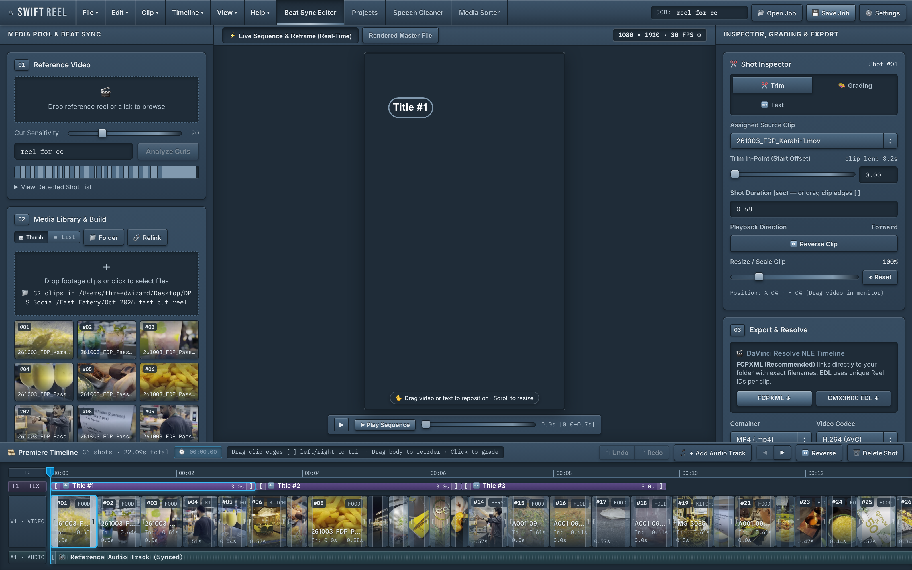
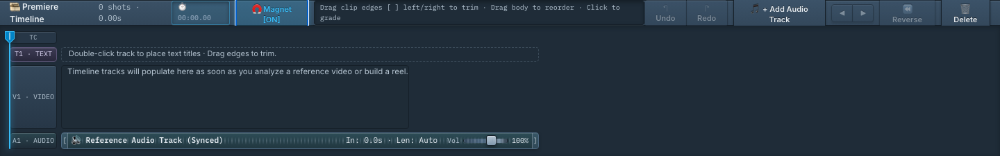
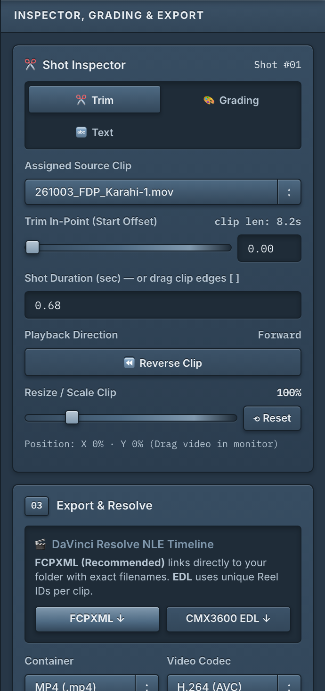
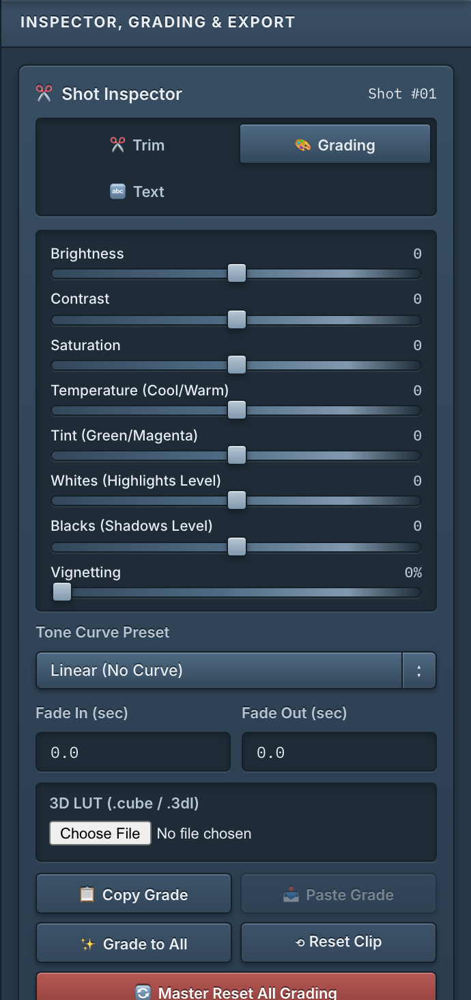
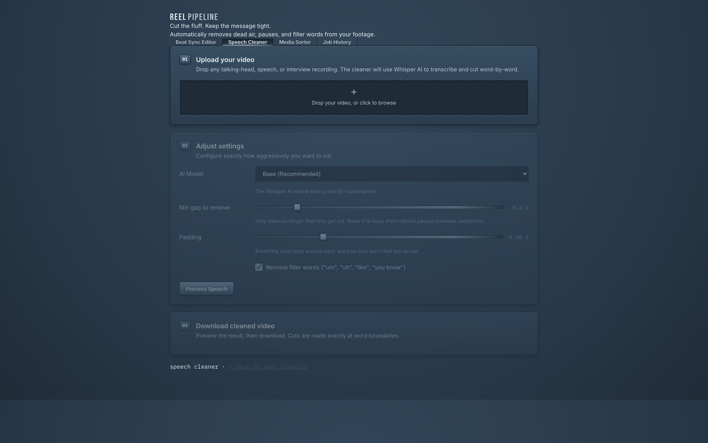
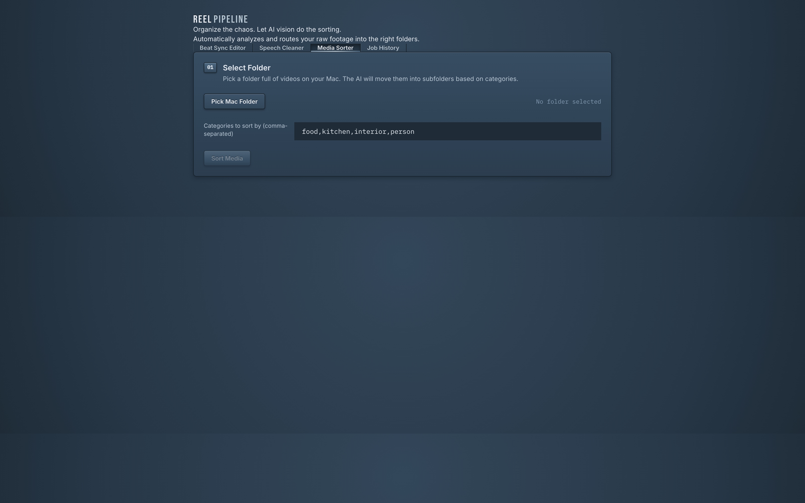

# Reel Pipeline — Complete User Guide & Studio Manual

> **Welcome to Swift Reel Studio!**  
> Think of this guide as your personal masterclass. Whether you are an experienced video editor or creating your very first short-form video, this handbook walks you through every single tool, shortcut, and creative technique step-by-step.

---

## Table of Contents
1. [The Studio Interface at a Glance](#1-the-studio-interface-at-a-glance)
2. [The 3-Step Beat-Sync Reel Workflow](#2-the-3-step-beat-sync-reel-workflow)
3. [Mastering the Multi-Track Timeline](#3-mastering-the-multi-track-timeline)
4. [Color Grading, 3D LUTs & Reframe](#4-color-grading-3d-luts--reframe)
5. [Text Titles & Typography (T1 Track)](#5-text-titles--typography-t1-track)
6. [Custom Audio & Music Sync (A1 Track)](#6-custom-audio--music-sync-a1-track)
7. [Exporting for Social Media & DaVinci Resolve](#7-exporting-for-social-media--davinci-resolve)
8. [AI Speech & Silence Cleaner](#8-ai-speech--silence-cleaner)
9. [AI Media Sorter](#9-ai-media-sorter)
10. [Keyboard Shortcuts Cheat Sheet](#10-keyboard-shortcuts-cheat-sheet)
11. [Pro Tips & Secret Shortcuts](#11-pro-tips--secret-shortcuts)

---

## 1. The Studio Interface at a Glance

When you launch **Reel Pipeline**, you enter a dark-themed, DaVinci Resolve-inspired digital editing suite divided into four purpose-built zones:



1. **Top Control Bar:** Project title, Undo/Redo buttons, quick job presets, and project save/open controls.
2. **Left Panel (Media Bin & AI Controls):** Where you drop your reference video, select your raw camera footage folder, adjust cut-detection sensitivity, and trigger AI content tagging.
3. **Center Stage (Live Preview Monitor):** Tri-deck 9:16 vertical playback monitor with clear visual differentiation:
   - **🎬 Reference Reel Tab (Amber):** Displays your imported reference video with an amber glowing border and status pill (`🎬 REFERENCE REEL · PACING & RHYTHM GUIDE`). Clearly tagged as a read-only guide so you never mistake it for camera footage.
   - **⚡ Live Sequence Tab (Cyan):** Seamless zero-latency dual-deck playback showing your actual working camera clips on the timeline (`🎞️ SHOT #01: clip.mp4`), with live click-and-drag pan/zoom reframing and text overlays.
   - **Rendered Master Tab:** Plays back the final high-bitrate baked video file after clicking Build Reel.
4. **Right Inspector Panel:** Detailed per-clip controls for framing, pan & zoom, white balance, tonality curves, 3D LUTs, vignettes, fades, and text styling.
5. **Bottom Dock (Multi-Track Timeline):** DaVinci Resolve-style continuous multi-track timeline featuring a Timecode Ruler (TC), Text Track (T1), Video Track (V1), Audio Track (A1), and interactive 60 FPS playhead (CTI).

---

## 2. The 3-Step Beat-Sync Reel Workflow

Creating a viral, fast-cut, rhythm-matched reel takes under 3 minutes:

```
[ Step 1: Ingest Reference ] ➔ [ Step 2: Smart-Match Content ] ➔ [ Step 3: Build & Refine ]
```

### Step 1: Analyze Your Reference Video
1. Find any high-performing Instagram Reel, TikTok, or YouTube Short whose pacing and rhythm you admire.
2. In the **01 Reference Video** section on the left, click **🎬 Load Reference** and select your single reference MP4 or MOV.
3. Keep the **Cut Sensitivity** slider at the default `20` (or raise it if you want only hard cuts detected).
4. Click **Analyze Cuts**.
   - *What happens:* PySceneDetect scans the video frame-by-frame, finds every cut point, and builds an exact rhythm map showing the duration of every single beat.
   - *Detected Shot List:* Expanding the shot list displays **10 shots at a time** with sticky headers and precise in/out timecodes for rapid review.

### Step 2: Ingest Footage & Smart-Match
1. In **02 Media Library**, click **📁 Folder** to pick a folder on your Mac SSD, or click **+ Clips** to select specific video files.
2. The **Media Library** expands to fill the entire sidebar height with high-density thumbnails. Toggle between **▦ Thumb** and **☰ List** views anytime.
3. *(Optional AI Power)* Check **AI Smart-Match by Content (CLIP Vision)**.
   - Type category keywords that match your video (e.g. `food, kitchen, cocktail, exterior, person`).
   - Click **🤖 Tag Content with AI**.
   - *What happens:* OpenAI CLIP analyzes your footage and matches your shots to the rhythm map by visual subject matter rather than random alphabetical order!

### Step 3: Build the Reel
1. Click **⚡ Build Reel & Timeline**.
2. Within seconds, your reel is compiled, color-graded, reframed to 9:16 vertical, and loaded directly onto the interactive timeline for fine-tuning.

---

## 3. Mastering the Multi-Track Timeline

The timeline is designed to feel just like **DaVinci Resolve** and **Adobe Premiere Pro**:



### Linear Timecode & Playhead (CTI)
* Every second on the timeline is mathematically locked 1:1 to the playback monitor ($120\text{ px/sec}$).
* Drag the **cyan playhead** (`⏱️ CTI`) or click anywhere on the **TC Ruler** to scrub through your edit in real time at butter-smooth 60 FPS.

### Trimming Clip In-Points and Out-Points (`[ ]`)
* Hover your mouse over the **left edge** of any video card to reveal the `[` handle. Drag it left or right to change where the clip starts.
* Hover over the **right edge** to reveal the `]` handle. Drag it left or right to lengthen or shorten the clip.
* **Auto-Scroll Runway:** There is a generous 650px blank runway past the end of the timeline. If you drag the last clip toward the edge of your screen, the timeline automatically scrolls horizontally with you!

### Magnetic Snapping Tool (`🧲`)
* **Toggle Snapping:** Click the **🧲 Magnet [ON]** button on the timeline toolbar, or tap the <kbd>N</kbd> key on your keyboard (the universal Premiere Pro / DaVinci Resolve snapping shortcut).
* **Cyan Magnetic Guide Line:** When dragging clip trim handles, sliding text titles, or scrubbing the CTI playhead near a cut or layer boundary, an illuminated vertical cyan guide line (`#38BDF8`) snaps across all timeline tracks, locking your edit to the exact sub-frame.
* **Magnetic Snap Targets:**
  - **Video Cut Boundaries:** Snap text titles and playhead directly to shot transitions.
  - **Playhead (CTI) Position:** Park the playhead on an audio beat or spoken cue, then drag a clip's trim edge to snap right to the playhead!
  - **Text Track Boundaries:** Snap adjacent titles together without awkward gaps or text overlaps.
  - **Custom Audio Start/End:** Snap video cuts and text layers precisely to musical drops or track starts.
  - **Sequence Start (0.00s):** Easily align initial layers to the very first frame.
* **Freeform Mode:** Tap <kbd>N</kbd> or click the magnet button to turn it into **🧲 Magnet [OFF]** whenever you want unrestricted, sub-pixel dragging without magnetic pull.

### Reversing Clips (`⏪`)
* Click any clip on the V1 track, then click **⏪ Reverse** on the toolbar (or press <kbd>R</kbd>).
* The clip will instantly show a `⏪ REV` badge and play backwards in full original 4K/1080p resolution in the monitor!
* *Non-destructive:* Your original camera file is never touched or overwritten.

### Replacing Clips with External Media (`🔄`)
* **Isolated Shot Replacement:** You can swap any individual shot on the timeline with an external video file from anywhere on your Mac SSD, even if it is not inside your media library folder.
* **How to Replace:** Select the shot card on the timeline, then click **🔄 Replace** on the timeline toolbar (or click **🔄 Replace Clip...** in the Inspector, or press <kbd>⌥R</kbd>).
* **Auto-Pool Replaced Toggle:**
  - **When ON (Default):** The replacement footage is automatically added into your **Media Pool** with an instant thumbnail, allowing you to easily reuse it on other shots or select it from the Assigned Clip dropdown.
  - **When OFF:** The replacement clip remains strictly isolated to that single shot on the timeline, keeping your Media Pool clean and untouched.
* **Multi-Use Footage Protection:** If other shots in your timeline share the same original clip from your media library, replacing this shot will **never** alter those other shots. Only the active shot is swapped.
* **Full Live Monitor & Bake Support:** The live monitor immediately loads and previews the new clip, and clicking **⚡ Build Reel (Bake Edits)** bakes the replacement footage into the final rendered reel.

### Deleting Layers & Clips (`🗑️`)
The timeline features a smart, context-aware delete tool:
1. **To delete a Text Layer:** Click the text title on the T1 track, then click **🗑️ Delete Text** (or press <kbd>Delete</kbd> / <kbd>Backspace</kbd>).
2. **To delete a Video Shot:** Click the video card on the V1 track, then click **🗑️ Delete Shot** (or press <kbd>Delete</kbd> / <kbd>Backspace</kbd>).
3. **To clear the Custom Audio Track:** Click the A1 audio track, then click **🗑️ Clear Audio** (or press <kbd>Delete</kbd> / <kbd>Backspace</kbd>).
4. *Made a mistake?* Press <kbd>⌘Z</kbd> anytime to undo up to 10 steps back!

---

## 4. Color Grading, 3D LUTs & Reframe

Click any clip on the timeline and explore the **Inspector Panel** on the right:




### Spatial Reframe (Pan & Zoom)
* Drag the **Zoom** slider to crop into the action (100% to 300%).
* In the live preview monitor, **click and drag the video with your mouse** to reposition the framing horizontally or vertically!
* Scroll your mouse wheel directly over the video to zoom in and out.
* Click **✨ Apply Reframe to All Shots** if you want your framing style applied across the entire video.

### DaVinci Resolve-Style White Balance
* **Temperature Slider:** Slide right for warm, rich golden amber tones; slide left for cool, cinematic blue tones.
* **Tint Slider:** Balance magenta and green tones with true photographic accuracy.
* Uses an exact mathematical RGB matrix that avoids the fake green/purple wash of generic web filters.

### Curves, Tonality & 3D LUTs
* **Tonality Curves:** Choose between *Standard Linear*, *Punchy S-Curve (Rich Contrast)*, *Filmic Muted Roll-Off*, or *High-Key Clean Pop*.
* **Vignette:** Add natural optical lens falloff to draw the viewer's eyes directly to the center of the dish or subject.
* **Fades:** Add smooth fade-from-black or fade-to-black transitions in tenths of a second.
* **3D LUT Support:** Click **Load .CUBE LUT** to apply your favorite DaVinci Resolve or camera manufacturer color grading LUTs (`.cube`).
* **1:1 WYSIWYG Monitor-to-Bake Color Parity & ☀️ Dedicated HDR Toggle:**
  - **☀️ HDR [ON] / [OFF] Button:** Located right on the center monitor toolbar, this button switches between **10-bit HDR Master (BT.2020 · HLG)** and **Standard SDR (Rec.709)** editing and export modes in a single click.
  - **When HDR Mode is ON (`☀️ HDR [ON]`):**
    - The entire project renders to **10-bit HEVC (`hvc1`, `yuv420p10le`, `bt2020`, `arib-std-b67`)**, perfect for Instagram HDR Reels and YouTube Shorts 4K HDR.
    - **Default iPhone Camera HDR (`arib-std-b67` HLG):** Passes through in full native 10-bit HDR with zero SDR tonemapping compression, keeping 1000-nit highlights shining.
    - **Apple Log & Flat Profiles (Blackmagic Camera App / ProRes 422 HQ):** Wide color gamut is fully preserved in 10-bit for precision LUT and manual grading, without arbitrary HLG curve distortion.
    - **Standard SDR Footages (Rec.709):** In an HDR project, standard SDR clips are mapped into the BT.2020 HLG container at reference broadcast diffuse white (75% code value / 203 nits per ITU-R BT.2408), preventing discolored or dimmed playback alongside HDR shots.
  - **When HDR Mode is OFF (`☀️ HDR [OFF]`):**
    - The sequence exports in standard Rec.709 SDR. Only true iPhone HLG footage receives gentle highlight roll-off so glassware, ice cubes, and lights match the monitor without blowing out into nuclear white. Flat profiles and SDR clips pass through uncorrupted.

---

## 5. Text Titles & Typography (T1 Track)

Add stylish, modern captions and title cards that elevate your video:

1. **Add Text:** Double-click any empty space on the purple **T1 · TEXT** track, or click **+ Add Text Item** in the inspector.
2. **Position & Trim:** Drag the text card along the timeline to choose when it appears. Drag its `[` and `]` handles to set how long it stays on screen.
3. **Interactive On-Screen Drag:** In the live monitor, **click and drag the text title directly** to position it anywhere on screen!
4. **Custom Fonts:** Click **Upload Font (.ttf / .otf)** to import your brand's official typography.
5. **Background Styles:** Choose between clean transparent text, blurred frosted glass, semi-black badges, or glowing drop shadows.

---

## 6. Audio Architecture: Reference Audio vs Clip Audio vs Custom Music

Reel Pipeline gives you studio-grade multi-track audio control designed specifically for short-form rhythm editing:

```
┌────────────────────────────────────────────────────────────────────────┐
│                          AUDIO SOURCES COMPARED                        │
├───────────────────┬────────────────────────────────────────────────────┤
│ 🔊 REFERENCE AUDIO│ The soundtrack/music extracted directly from the   │
│                   │ reference video reel. Used as the master rhythmic  │
│                   │ pacing guide so every cut lands on the beat.       │
├───────────────────┼────────────────────────────────────────────────────┤
│ 🎙️ CLIP AUDIO      │ The camera's original microphone audio (kitchen    │
│                   │ sizzles, dialogue, clinking glasses, ambient sound)│
│                   │ embedded inside each raw video file.               │
├───────────────────┼────────────────────────────────────────────────────┤
│ 🎵 CUSTOM AUDIO   │ An external MP3/WAV/M4A song or voiceover loaded   │
│    (A1 Track)     │ onto the timeline to replace the reference music.  │
└───────────────────┴────────────────────────────────────────────────────┘
```

### What does "Reference Audio" stand for?
When you load an inspiring Instagram Reel or TikTok reference video into the app, Reel Pipeline analyzes its visual cuts and extracts its **audio track**.
* **Purpose:** Acts as your reference soundtrack and tempo grid. When you build the reel, your raw camera clips are synchronized to the cuts and beats of this soundtrack.
* **When to use it:** When you want your finished reel to use the exact trending music or voice pacing of the reference video.

### What does "Clip Audio" stand for?
Clip Audio is the **natural sound recorded by your camera or smartphone microphone** when shooting your footage.
* **Purpose:** Provides atmospheric richness—such as sizzling steaks, pouring wine, crackling fire, footsteps, or natural room reverberation.
* **How to toggle it:** Check the **"Keep Original Clip Audio"** checkbox on the left panel (or in project settings).
* **When to check it:** When you want the viewer to hear delicious cooking sounds or live atmosphere subtly mixed underneath the background music.
* **When to uncheck it:** When your raw footage has distracting wind noise, camera operator chatter, or poor quality camera audio, and you want a clean music-only master.

### Adding Custom Music (A1 Track)
To replace the reference soundtrack with your own song or licensed track:
1. Click **🎵 + Add Audio Track** on the timeline toolbar and select any MP3, WAV, or M4A file.
2. The **A1 · AUDIO** track lights up with a green waveform.
3. **Adjust Timing:** Drag the left handle `[` to offset where the music starts. Drag the right handle `]` to trim its duration.
4. **Volume Control:** Use the volume slider on the track header to mix background music between 0% and 150%.
5. **Layer with Clip Audio:** If **Keep Original Clip Audio** is checked, Reel Pipeline automatically blends both tracks in stereo, giving you professional audio layering with zero clipping.

---

## 7. Exporting for Social Media & DaVinci Resolve

When your edit is ready, click **🚀 Export Selected Formats** on the left panel:

### 1. Direct Social Media Presets
* **Instagram Reels & Stories:** 1080×1920 @ 30 FPS, optimized for Instagram's compression engine.
* **TikTok Master:** 1080×1920 with high-bitrate audio and fast metadata start.
* **YouTube Shorts (4K Master):** 2160×3840 vertical 4K master file with pristine bitrate.

### 2. Industry Handoff (DaVinci Resolve & Premiere Pro)
Never get trapped in an AI app! Reel Pipeline gives you full NLE project handoff:
* **Download FCPXML (v1.9):** In DaVinci Resolve, go to *File ➔ Import ➔ Timeline* and select the `.fcpxml`. Resolve instantly recreates your exact timeline, linking each cut directly to your original 4K/6K camera files on disk!
* **Download EDL (CMX 3600):** Industry-standard Edit Decision List with accurate SMPTE timecodes.

---

## 8. AI Speech & Silence Cleaner

Need to turn a raw interview, talking-head video, or podcast into a punchy clip? Switch to the **Speech Cleaner** tab:



1. Drop your raw spoken video file into the box.
2. Click **Clean Speech & Cut Dead Air**.
3. **What the AI does:** OpenAI Whisper listens to the audio, transcribes every word with millisecond precision, and identifies all pauses longer than 0.45 seconds as well as filler words ("um", "uh", "er").
4. It cleanly slices out the dead air and joins the speech segments together seamlessly without changing audio pitch.

---

## 9. AI Media Sorter

Have a camera card with 50+ mixed clips? Switch to the **Media Sorter** tab:



1. Select your messy folder of video files.
2. Type the categories you want (e.g. `Cocktails, Food Dishes, Chef Action, Interior Dining`).
3. Click **🤖 Sort Media with AI**.
4. OpenAI CLIP inspects every video and automatically sorts them into organized subfolders on your Mac, ready for your next project.

---

## 10. Keyboard Shortcuts Cheat Sheet

| Shortcut | Action | Description |
| :--- | :--- | :--- |
| <kbd>Spacebar</kbd> | **Play / Pause** | Toggles sequence playback or active monitor preview |
| <kbd>N</kbd> | **Magnet / Snapping** | Toggles magnetic snapping on/off across all timeline tracks |
| <kbd>R</kbd> | **Reverse Clip** | Toggles reverse playback for the selected video shot |
| <kbd>⌥R</kbd> | **Replace Clip** | Replaces the selected shot with an external video file |
| <kbd>Delete</kbd> / <kbd>Backspace</kbd> | **Delete Layer** | Deletes the active text title, video shot, or audio track |
| <kbd>⌘Z</kbd> | **Undo** | Reverts the last action (up to 10 steps back) |
| <kbd>⇧⌘Z</kbd> / <kbd>⌘Y</kbd> | **Redo** | Redoes the previously undone action |
| <kbd>⌥C</kbd> | **Copy Color Grade** | Copies the color grade of the selected clip |
| <kbd>⌥V</kbd> | **Paste Color Grade** | Pastes the color grade onto another selected clip |
| <kbd>⌘S</kbd> | **Save Project** | Saves the current edit as a `.reelproj` bundle |
| <kbd>⌘O</kbd> | **Open Project** | Opens an existing `.reelproj` bundle |
| <kbd>⌘B</kbd> | **Build Reel** | Bakes all edits and renders the timeline |
| <kbd>◀</kbd> / <kbd>▶</kbd> | **Reorder Shots** | Shifts the selected shot earlier or later in the edit |
| <kbd>⌘1</kbd> | **Beat Sync Tab** | Switches to the main Beat Sync Studio |
| <kbd>⌘2</kbd> | **Cleaner Tab** | Switches to the AI Speech Cleaner |
| <kbd>⌘3</kbd> | **Sorter Tab** | Switches to the AI Media Sorter |

---

## 11. Pro Tips & Secret Shortcuts

1. **Copy & Paste Color Across Clips:** Grade one shot perfectly, press <kbd>⌥C</kbd>, click any other shot on the timeline, and press <kbd>⌥V</kbd> to copy the exact grade instantly.
2. **Smooth Reframe Scrolling:** Place your cursor over the preview monitor and scroll up/down with your trackpad or mouse wheel to adjust zoom in real-time.
3. **Preserving 4K Camera Masters:** Use the **FCPXML** export feature to take the AI's edit straight into DaVinci Resolve for final Dolby Vision or HDR grading.
4. **Zero-Lag Scrubbing:** Click and drag directly on the **Timecode Ruler (TC)** above the video track to scrub at 60 FPS through cuts like a professional editor.

*Happy editing with Swift Reel Studio!*
